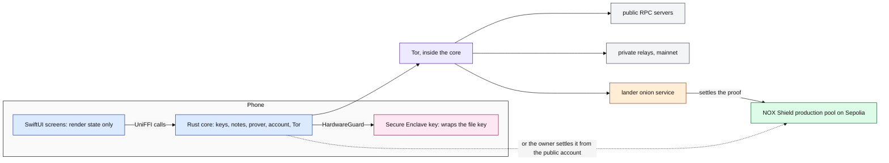
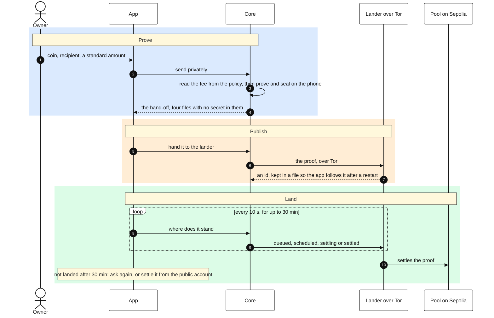
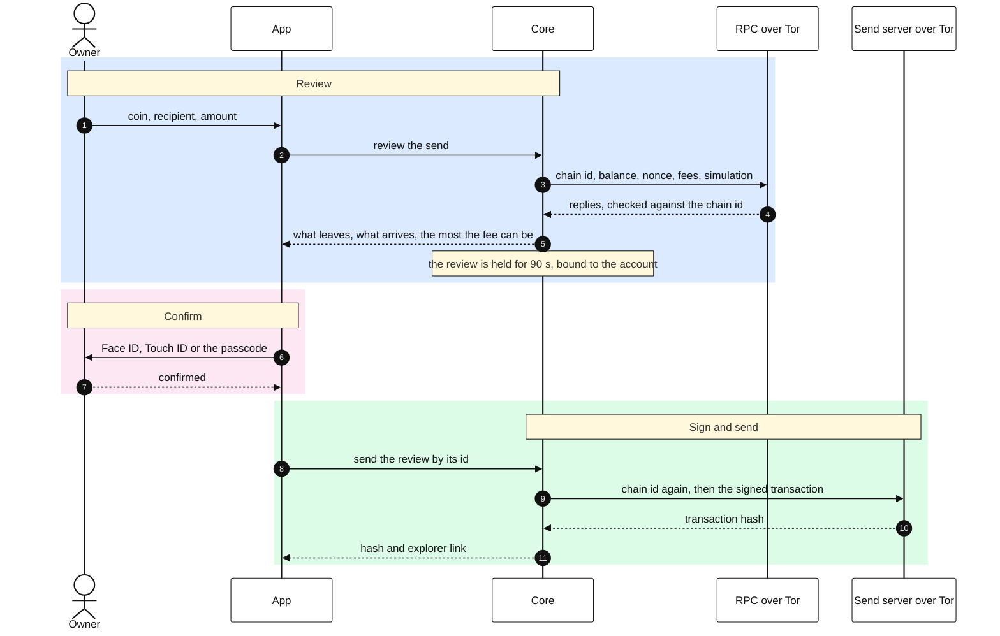

# NØNOS Wallet for iOS

The iOS app of NØNOS Wallet, a phone wallet for NOX Shield: private transfers on Ethereum, proved on the phone and verified on chain.

> [!WARNING]
> The shield runs on Sepolia only, and its tokens have no value. The public account moves real
> funds on Ethereum mainnet. Nothing is audited: not the app, not the core, not the pool. The
> proving time on a phone is not published, because it needs the median of three runs whose
> proofs the live verifier accepts ([06-measure.md](docs/06-measure.md)). There is no TestFlight or
> App Store build ([05-distribution.md](docs/05-distribution.md)). What the core checks and what it
> does not is in [its security status](https://github.com/NON-OS/shield-core/blob/main/docs/20-security-status.md).

| Fact | Value | Source |
|---|---|---|
| Proof system | a STARK over the Goldilocks field with FRI, hash-based, no trusted setup, proved on the phone by the core | [the core README](https://github.com/NON-OS/shield-core) |
| Pool | the NOX Shield production pool on Sepolia, `0xaEe51E82965Ec1DeD870F3f4c248Ad4AdDc3e1cb`, from block 11,817,433 | `core/src/net/pools.rs` in the core, at the commit in `core.lock` |
| Proof size | 94,760 to 95,752 bytes for the core's four pinned vectors, each a 40-byte header and the proof | `core/tests/prod_vectors.rs` in the core |
| Verifier cost | 3,934,660 gas for the first settlement on the production pool, through its lander | settlement [`0x93bd48ea…ec0d`](https://sepolia.etherscan.io/tx/0x93bd48eab8253ce497afbdc3fca7071a1d24a73599c866bd599101e301d2ec0d), block 11,817,581 |
| Amounts | standard sizes only, 1, 2 or 5 times a power of ten: 1,000 to 5,000,000 NOX, 0.01 to about 18.44 ETH | `core/src/net/asset_v2.rs` in the core |
| Fee of a spend | the protocol part, 400 NOX or 0.0005 ETH for a private transfer and 0.50% of a withdrawal, plus one rung of the gas ladder picked from the base fee, the lowest 2,000 NOX or 0.0025 ETH. Read from the policy `0x660f66ab31Ca9919D9e1770FEDc88Ff2dd29CE59` and checked by it before any proving, never typed | `core/src/net/fee_schedule.rs`, `core/src/net/asset_v2.rs` in the core |
| Fee of a deposit | 0.25%, shown on the review as the pool fee before the owner confirms | the core README, Who controls the pool; `Views/ShieldReviewView.swift` |
| Privacy wait | a note is spent after 20 more notes and about 6 hours, counted down by the meter; typing EARLY skips it | `core/src/wallet/spend/ripe.rs` in the core, `Views/PrivacyMeter.swift` |
| Landers | five onion services, tried in order and given 20 seconds each, over the Tor client inside the core, each checked for the production pool first ([the list](https://github.com/NON-OS/shield-core/blob/main/docs/03-transport.md)). A proof pays whoever settles it, so the owner can settle it from the public account instead | `core/src/net/pools.rs`, `core/src/net/relay/landers.rs`, `core/src/ffi/wallet/settle_self.rs` in the core |
| Trust model | every decision about money is taken in the core. The app holds the window, the Secure Enclave key and the screens | [02-app.md](docs/02-app.md) |
| Networks | the shield on Sepolia. The public account on Ethereum mainnet and Sepolia. Swaps on mainnet only | `core/src/evm/network.rs` in the core |

This repository holds presentation and platform integration. The prover, the note store, the key
custody, the Ethereum account and the network client live in the Rust core,
[shield-core](https://github.com/NON-OS/shield-core), and every decision about money is taken there. The claims about the
core, with their evidence, are in its README.

## How it fits together

The app, the core inside it, and what the core reaches over Tor. One colour per actor.



A private send, from the form to the settlement. The steps under the third box are the ones the
waiting screen shows (`State/Landing.swift`).



A public send, from the review to the hash. Nothing is signed before the core has worked out the
send in full and the platform has confirmed the owner.



| Doc | What it covers |
|---|---|
| [01-setup.md](docs/01-setup.md) | the user guide: making a wallet and using each screen |
| [02-app.md](docs/02-app.md) | what the app owns and trusts, and what an attacker can do |
| [03-reproduce.md](docs/03-reproduce.md) | the pinned toolchain and how to compare a build with a release |
| [04-install.md](docs/04-install.md) | installing the unsigned release with SideStore or AltStore |
| [05-distribution.md](docs/05-distribution.md) | signing, TestFlight and App Review, and what they wait on |
| [06-measure.md](docs/06-measure.md) | measuring a proof on a phone, and the report to the prover team |
| [tutorial/](docs/tutorial/) | the tutorial video: script, shot list, on-screen steps and captions |

## What works today

| What | Evidence |
|---|---|
| The app builds for devices from the pinned core and each tagged release publishes the unsigned IPA with its SHA-256 | [Releases](https://github.com/NON-OS/shield-ios/releases), `scripts/release-ipa.sh` |
| Create or restore from recovery words, sealed under a Secure Enclave key that opens only when the owner is present. On a phone the Enclave is the only place the key may be | `NoxShield/Core/EnclaveGuard.swift`, `NoxShield/Core/EnclaveKey.swift`, `NoxShield/Core/Holder.swift` |
| The public account: ETH, NOX and USDC on Ethereum and on Sepolia, send and receive | `NoxShield/State/Account.swift`. Every send is reviewed by the core, then confirmed with Face ID, Touch ID or the passcode |
| Swaps between ETH, NOX and USDC on Ethereum mainnet | `NoxShield/State/Swapping.swift`, `NoxShield/Views/SwapReviewView.swift` |
| The shield on the production pool: deposit signed from the public account, receive at a `nox1` address, send privately, withdraw, take back | `NoxShield/State/Money.swift`, `NoxShield/State/TakeBack.swift` |
| A spend proved on the phone, handed to the lander over Tor, and followed in five steps to its settlement, again after the app is closed; after 30 min with no landing, asked again or settled from the public account | `NoxShield/State/Relaying.swift`, `NoxShield/State/Landing.swift`, `NoxShield/Views/LandingSteps.swift`, `NoxShield/State/SelfSettle.swift`, `NoxShieldTests/LandingTests.swift` |
| A spend waits for 20 more notes and about 6 hours after a deposit, with a privacy meter that counts both down, and a typed EARLY to skip it | `NoxShield/Views/PrivacyMeter.swift`, `NoxShield/Views/EarlyConfirm.swift` |
| Each withdrawal is filled in with an unused address of the same words, and a used address is warned about | `NoxShield/Views/WithdrawNote.swift`, `NoxShield/Views/SpendForm.swift` |
| Restore from recovery words of any standard length, or from a private key | `NoxShield/Views/RestoreView.swift` |
| Several accounts from one phrase, found again after a restore, each named on every review | `NoxShield/State/Accounts.swift`, `NoxShield/Views/AccountsPanel.swift`, `NoxShield/Views/FromNote.swift` |
| A proof timed on the phone, with the kernel's own peak memory and the limit iOS ends the app at, on every core or two threads | `NoxShield/Views/BenchPlate.swift`, `NoxShield/Core/Footprint.swift`, `NoxShield/Core/Threads.swift`, `NoxShieldTests/MemoryTests.swift` |
| Jailbreak signs named on the welcome screen and in Settings, and none found said as none found | `NoxShield/Core/Integrity.swift`, `NoxShieldTests/IntegrityTests.swift` |
| Every core failure has one sentence, the same as on Android | `NoxShieldTests/FailuresTests.swift` |

## How to verify it

Check the hash of the release before installing it:

```sh
shasum -a 256 -c NONOS-<tag>-unsigned.ipa.sha256
```

The unsigned release carries no signature: SideStore or AltStore signs it on the phone with the
Apple ID of the owner, so no signing key is needed to build it. [04-install.md](docs/04-install.md)
takes it from there.

## How to build it

| Tool | Version | Where it is pinned |
|---|---|---|
| The core | the commit in `core.lock` | `scripts/build-core.sh` refuses any other |
| Rust | 1.91.1 | `rust-toolchain.toml` in the core |
| Xcode | 16.4, recorded with each build | `scripts/build-core.sh` writes it into the app, and Settings shows it |
| iOS | 18.0 or later | `project.yml` |

```sh
scripts/build-core.sh      # the core for the device, and the Swift bindings
xcodegen generate          # the Xcode project, which is not committed
open NoxShield.xcodeproj
```

Everything is built and checked on the build server, a Mac; nothing runs on GitHub Actions.

```sh
NOX_SLICES=device scripts/build-core.sh   # the core for phones
scripts/release-ipa.sh vX.Y.Z             # on the tag: the unsigned .ipa and its SHA-256
scripts/testflight.sh X.Y.Z               # signed and uploaded, once the account exists
```

| Check | What it holds | How it runs on the server |
|---|---|---|
| Build and unit tests | the app builds against the pinned core, and every test passes | `xcodebuild test -scheme NoxShield` on an iPhone simulator |
| Lint | SwiftLint strict, files under 70 lines, functions under 40 | `scripts/lint.sh` |
| Declarations | an empty privacy manifest, no shared entitlement, no tracking framework, no URL, no App Transport Security exception, no log call | `scripts/check-privacy.sh` |
| Screens and accessibility | every screen photographed, with Xcode's accessibility audit, and again at the largest text size | `xcodebuild test -scheme Screens` on an iOS 26 simulator, `NoxShieldUITests/` |

## Limits

- The shield runs on Sepolia only. Swaps run on Ethereum mainnet only.
- The send screen shows the fee at the lowest rung, which is what every spend pays. The split into a
  network part and a protocol part, which the core quotes, is not on this screen yet.
- Splitting one deposit into several standard sizes is in the core and not yet on a screen.
- The App Store build leaves swaps out; the sideloaded build keeps them (`Core/Release.swift`).
- The app reads the production pool only. Notes deposited on the earlier launch and v2 pools are
  not shown, and the app does not move them (`ACTIVE` in `core/src/net/pool.rs` in the core).
- Nothing here has been audited.
- There is no TestFlight or App Store build. The unsigned release is installed with SideStore or
  AltStore ([04-install.md](docs/04-install.md)).
- The proving time on a phone is not published yet: it must be the median of three runs, each
  proof accepted by the live verifier ([06-measure.md](docs/06-measure.md)).
- iOS gives an app no way to block a screenshot the owner takes. A screenshot of the recovery
  words is answered with a warning to delete it.
- The jailbreak signs find common jailbreaks. One built to hide shows none, and the app says so.

## Security and privacy

- The seed is sealed under a key generated inside the Secure Enclave, bound to this device and to
  the owner being present. The key cannot be exported. On a phone the app refuses to seal the seed
  anywhere else; the keychain fallback exists only for the simulator, which has no Enclave.
- The container of the app is excluded from backup, so the vault and the note store never reach
  iCloud or a computer backup. There is no iCloud entitlement, no keychain sharing and no app
  group.
- The vault and the note store use complete data protection: unreadable, to the app as well, while
  the phone is locked.
- There is no analytics, no crash reporter and no attribution framework, and nothing is logged:
  `scripts/check-privacy.sh` fails the check on any print, `NSLog`, `os_log` or `Logger` call. The
  settings are files in the container, so the privacy manifest declares no required-reason API.
- Every connection goes through the Tor client in the core. The app itself opens none, and App
  Transport Security stays at its default with no exception, which the same script holds.
- The window is covered when the app leaves the foreground, and while the screen is recorded,
  mirrored or shared, so no snapshot holds a balance, an address or the recovery words. Recording
  can be allowed in Settings; the words and keys stay hidden from it either way.
- A copied address or hash stays on this device and is cleared from the pasteboard after a minute.
- There are no notifications, so no amount can appear on a lock screen.

Report a flaw to ek@nonos.systems or team@nonos.systems.

## Layout

| Path | What is in it |
|---|---|
| `NoxShield/Core` | The Secure Enclave guard, storage and file protection, owner confirmation, the platform readings |
| `NoxShield/State` | One state value, one background queue, the actions |
| `NoxShield/Views` | The screens, which render state and nothing else |
| `scripts/build-core.sh` | Builds the core and generates the bindings |

The design is Etna, after the volcano of Sicily: each section opens with a recoloured photograph of
Etna in eruption. The photographs are by gnuckx under CC BY 2.0, credited in Settings, About,
Acknowledgements.

## Licence

AGPL-3.0-or-later.
